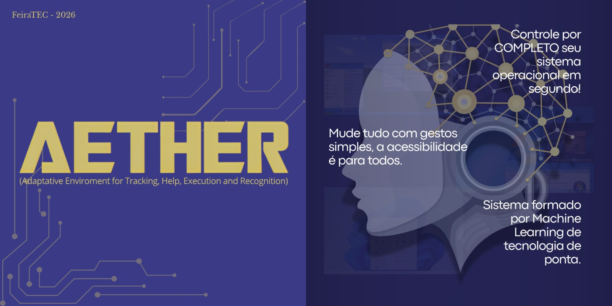
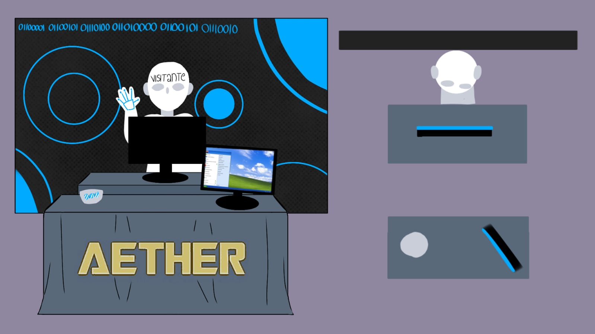

# Feira Tecnológica - Projeto AETHER

Sistema de controle de computador por gestos aéreos em tempo real, utilizando webcam, MediaPipe Tasks, PyAutoGUI, integrado à aplicação Mobile desenvolvida com Flutter e inteligência artificial.

---

## 👥 Integrantes e Informações Acadêmicas

**Disciplina:** Desenvolvimento Mobile / Inteligência Artificial  
**Professora:** Joelma Sartori  
**Integrantes da Dupla/Grupo:**
- Aluno 1 (Ana Carolina Lopes Reis / 25096)
- Aluno 2 (Julia Cavalcante Leão / 25230)
- Aluno 3 (Maria Rita Barbosa Lima Albuquerque dos Santos / 25021)
- Aluno 4 (Mayara Teles / 25122)
- Aluno 5 (Willian Bernardo Soares Pereira / 25018)

---

## Esboço do stand do projeto

---

## 🎪 Proposta para a Feira Tecnológica / de Ciências

**Tema / Nome do Projeto:** Gerenciamento de janelas com movimentos das mãos para facilitar o uso de computadores para pessoas com deficiências / AETHER (Adaptive Environment for Tracking, Help, Execution, and Recognition)  

**Problema que busca resolver / Proposta de Valor:** O projeto busca facilitar o uso de computadores para pessoas com deficiências motoras, que dificultam o uso do teclado e mouse tradicional. Sendo assim, foi desenvolvido um método onde o usuário utiliza as mãos para movimentar as janelas e interagir com o sistema.  

**Público-Alvo:** Pessoas com dificuldades motoras.  

**Como será a demonstração prática na feira:** A demonstração será feita com os computadores através da câmera, onde o avaliador poderá testar os movimentos possíveis e visualizar como o projeto funciona na prática.  

---

## 🖐️ Catálogo Completo de Gestos

### Contrato atual de gestos

| Gesto | Ação |
| :--- | :--- |
| 1 dwell | Clique esquerdo |
| 2 dwells | Clique direito |
| 🤏 Pinça | Arrastar janela |
| 🖐️ + 🤏 / pinça dinâmica | Zoom; afastar = zoom in, aproximar = zoom out |
| 👐 juntas, sobem e afastam | Maximizar |
| 👐 afastadas, descem e aproximam | Minimizar |
| ☝️ movimento vertical | Scroll |
| Círculo horário | Avançar |
| Círculo anti-horário | Desfazer (`Ctrl+Z`) |
| Swipe de palma | Trocar área de trabalho |
| 👐 posição de digitação | Abrir teclado virtual disponível |
| ⌨️ indicador parado | Clique esquerdo na tecla |
| 👌 OK | Ativar voz/digitação |
| 👍 Joinha | Enter/confirmar |
| ✊ punho mantido | Pausar; repetir retoma |
| 🖐️ inicial | Calibração automática |

Todas as mãos são validadas pelos 21 landmarks antes do processamento e passam por filtros temporais/tolerâncias para reduzir tremores.

---

## 🛠️ Tecnologias Utilizadas

- [Flutter](https://flutter.dev/)
- [Google Teachable Machine](https://teachablemachine.withgoogle.com/)
- [TensorFlow Lite](https://www.tensorflow.org/lite)
- [Git & GitHub](https://github.com/)

---

## 📁 Estrutura do Repositório

Esta branch (`main`) é dedicada à apresentação oficial e documentação do projeto. As versões específicas para execução em sistemas operacionais (Windows e Linux) encontram-se separadas em suas respectivas branches ou diretórios do repositório.

---

## 📋 Histórico de Commits e Atualizações

- `[25/08/2026]` - Criação do repositório e estrutura inicial.
- `[06/09/2026]` - Resumo da pesquisa sobre Machine Learning e Teachable Machine.
- `[06/09/2026]` - Adição da proposta e tema para a Feira Tecnológica.
- `[07/09/2026]` - Finalização do README e envio para avaliação.
